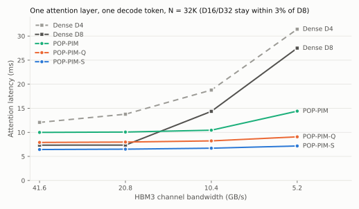

# POP-PIM


**Byte-frugal near-memory sparse attention over a standard memory channel.** POP-PIM scores the KV cache next to the
HBM banks with popcount-based retrieval metadata, selects the tokens that matter, and reads only their
original-precision K/V for exact attention. POP-PIM-S and POP-PIM-Q add three dataflow changes that cut the bytes
crossing the channel: GQA-shared selection, two-phase K→V gather with mass-guided V skipping, and compact host
transport. This repository contains the functional models, SystemVerilog RTL, a Ramulator 2 HBM3 architectural
simulator and the scripts that reproduce every reported number. The retrieval mathematics follows
[PopKV](https://github.com/kw78999/PopKV).

[Reproduction guide](docs/reproducing.md) · [Architecture and code map](docs/architecture.md) ·
[Interpreting the results](docs/results.md) · [한국어 안내](docs/guide_ko.md)

## How it works

| | Per layer and decode token |
|---|---|
| **Dense D#** | `#` BF16 FMA lanes per bank score every token; all 128 MiB of K/V cross the channel |
| **POP-PIM** | Banks score 40 B/token of popcount metadata; each query head picks its own Top-4,096, and the union of the four heads that share a KV head is read |
| **+ GS** (GQA-shared selection) | The four heads' BF16 logits are averaged in the bank, `((s0+s1)+(s2+s3))×0.25`; one Top-K per KV head (2.33× fewer selected rows) |
| **+ VS** (mass-guided V skipping) | After exact QK over the selected keys, V rows are read only for tokens needed to keep 1 − δ of each head's selected attention mass |
| **+ CT** (compact transport) | One 2-byte, position-implicit score per KV-head token goes to the host; indices come back as a bitmap |

**POP-PIM-S** = GS (K = 4,096) + VS (δ = 0.005) + CT and **POP-PIM-Q** = GS (K = 6,144) + VS (δ = 0.002) + CT, both
with the synthesized hardware VS rule. Top-k runs on the host (S path, measured 8-thread CPU) or on an on-chip
selector (L path). Refresh is PIM-aware and per bank. Details: [architecture](docs/architecture.md).

## Results

One Llama-3.1-8B attention layer (32 query / 8 KV heads), one decode token, N = 32,768, one HBM3 channel with
64 banks. POP-PIM rows use the S path with the measured CPU Top-k. Latency includes the VS scan. Area is the
**known partial area** per channel (mapped near-bank logic, SRAM estimates and support proxies), not a total chip
area.

| Configuration | 41.6 GB/s | 20.8 GB/s | 10.4 GB/s | 5.2 GB/s | Channel MiB | Host link MiB | Known partial area (mm²) |
|---|---:|---:|---:|---:|---:|---:|---:|
| Dense D4 | 12.067 | 13.770 | 18.786 | 31.430 | 128.0 | — | 4.99 |
| Dense D8 | 7.345 | 7.356 | 14.361 | 27.497 | 128.0 | — | 6.58 |
| Dense D16 | 7.345 | 7.355 | 13.971 | 27.671 | 128.0 | — | 9.95 |
| Dense D32 | 7.345 | 7.349 | 14.396 | 27.578 | 128.0 | — | 16.54 |
| POP-PIM | 9.991 | 10.064 | 10.447 | 14.408 | 55.8 | 8.50 | 9.65 |
| POP-PIM-Q | 7.908 | 7.984 | 8.227 | 9.072 | 29.3 | 0.53 | 11.89 |
| POP-PIM-S | **6.435** | **6.510** | **6.710** | **7.174** | 21.6 | 0.53 | 11.01 |

Attention latency in ms per channel bandwidth; bytes per layer and token.



POP-PIM-S moves 21.6 MiB per layer-token instead of 128 MiB (Dense) or 55.8 MiB (POP-PIM), and its latency grows by only 11% from 41.6 to 5.2 GB/s, versus 44% for POP-PIM and 274% for Dense D8. It is 1.14× faster than D8 at the nominal 41.6 GB/s and 3.83× faster at 5.2 GB/s, for 11.01 instead of 6.58 mm² of known partial area. At 41.6 and 20.8 GB/s Dense D8 still has the lowest area × delay; from 10.4 GB/s down POP-PIM-S does. D16 and D32 gain at most 2.7% over D8 for 1.5× and 2.5× its area: at 41.6 and 20.8 GB/s D8–D32 all wait on the shared softmax/AV backend (about 7.35 ms), and below that on the channel.

On Llama-3.1-8B with PG19 at 32K context (30 sparse layers), the mean relative attention-output error against dense
attention is 0.166 for POP-PIM, 0.145 for POP-PIM-S and 0.105 for POP-PIM-Q, with worst cases of 7.90, 2.11 and 1.71.
Perplexity over a 64-token sample is 22.39 (dense), 22.73, 22.57 and 22.50; all differences lie inside their 95%
bootstrap intervals ([quality summary](results/quality/README.md)). Ablations, host-link and refresh-policy
studies are in [`results/`](results/README.md); the scope and assumptions behind every number are in
[docs/results.md](docs/results.md).

## Quick start

Linux with Python 3.10 or newer (3.11 is the reference). No GPU, model weights or text corpus is needed.

**1. CPU checks and tables from the committed results (about a minute)**

```bash
python3.11 -m venv .venv && source .venv/bin/activate
python -m pip install -r requirements-lock.txt
python -m pip install --no-deps -e .
OPENBLAS_NUM_THREADS=1 OMP_NUM_THREADS=1 python -m pytest -q
python -m tools.rebuild_tables --suite main --output-dir outputs/tables/main
```

**2. Build the simulator and rerun three cases (about 5 + 1 minutes on four cores)**

```bash
sudo apt-get install -y build-essential g++-10 cmake verilator   # Ubuntu 20.04/22.04
export CXX=g++-10                 # the compiler used for the reference results
python -m tools.build --jobs 4
python -m tools.reproduce --suite quick
```

`quick` simulates Dense D8, POP-PIM and POP-PIM-S at 41.6 GB/s, audits each raw DRAM command trace, and compares
every metric with `results/main/runs.json`; it ends with `All 3 cases are identical ...` when the run reproduces.

**3. Full reproduction (about an hour on four cores)**

```bash
python -m tools.reproduce --suite main        # 28 cases: the table above
python -m tools.reproduce --suite ablation    # 121 cases: GS/VS/CT ablation, L path, host-link sweep
python -m tools.reproduce --suite refresh     # 45 cases: refresh policies
python -m tools.verify_rtl                    # Verilator checks of the GS, VS and refresh-scheduler RTL
```

Single cases, synthesis and CACTI area reproduction, host Top-k measurement on your machine and the optional
model-quality evaluation are described in the [reproduction guide](docs/reproducing.md).

## Repository layout

| Path | Contents |
|---|---|
| `poppim/` | Functional encoding, scoring and selection; integer BF16 oracles; GS replay and V-keep mask helpers |
| `rtl/` | Dense and popcount scorers, GQA4 router, score banks, GS unit, VS engine, S-path staging, refresh scheduler |
| `simulator/` | Ramulator 2 Dense/POP frontends, HBM3 controller with refresh policies, S-path and selector models |
| `tools/` | Build, inputs, simulation, trace audit, reproduction suites, tables, area model, RTL checks, synthesis |
| `experiments/` | Functional comparison; optional model-quality evaluation; regeneration of activation-derived masks |
| `configs/`, `data/` | HBM3 template; score replay, V-keep masks, RTL timing calibration, area components, host Top-k |
| `results/` | Reference records and tables of every suite, area and quality summaries, 0.1.0 references |
| `provenance/`, `third_party/` | Release manifest and validation records; vendored Ramulator 2, HardFloat and their licenses |

## Citation, license and contributing

See [CITATION.md](CITATION.md); the paper metadata is not final yet. No license has been chosen for the original
POP-PIM code yet ([LICENSE.md](LICENSE.md)); vendored third-party code keeps its own licenses
([THIRD_PARTY_NOTICES.md](THIRD_PARTY_NOTICES.md)). Bug reports and reproducibility fixes are welcome
([CONTRIBUTING.md](CONTRIBUTING.md)).
