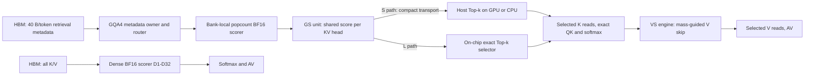

# Architecture and code map

POP-PIM moves approximate retrieval scoring next to the DRAM banks: every bank scores its share of the KV cache
from compact popcount metadata, a Top-k step selects the tokens worth reading, and only their original-precision
K/V rows cross the memory channel for exact attention. Dense near-memory baselines (`D#`) instead score every cached
token with `#` BF16 FMA lanes per bank. The two paths have different quality contracts; equal latency does not mean
equal output quality (see [results.md](results.md)).

## Workload and memory

One decode token of one Llama-3.1-8B attention layer: 32 query heads, 8 KV heads (GQA4), head dimension 128,
context N = 32,768 (Dense also 64K/128K). Memory is one HBM3 channel of the retained Ramulator 2 preset
(`HBM3_8Gb_2R`, `HBM3_5.2Gbps`): two pseudochannels, 64 banks, 41.6 GB/s. Lower channel bandwidths
(20.8/10.4/5.2 GB/s) lengthen the burst (`nBL` 4/8/16) of the same preset; there is no all-bank or in-bank bandwidth
amplification, so every byte read crosses the standard channel data bus. Clocks: 769 ps HBM/controller,
8,000 ps scoring (125 MHz), 4,000 ps selection, 2,000 ps completion.

## POP-PIM data paths

| Path | Design id | Top-k | Notes |
|---|---|---|---|
| S (score export) | `POP_S_GPU`, `POP_S_CPU` | on the host | Scores leave through 4 output lanes at 250 MHz and a 32 GB/s host link (5 µs start-up, 2 µs sync); indices return. GPU Top-k is an assumed 0.2 ms; CPU Top-k is a measured 8-thread median ([host_topk.json](../data/calibration/host_topk.json)). |
| L (local selector) | `POP_E4P4`, `POP_E24P32` | on chip | `E#/P#` = shared selector engines / selector SRAM ports; exact C++ selector model in `simulator/common/selector_cluster_sram.h`. |

### Byte-frugal dataflow (POP-PIM-S and POP-PIM-Q)

- **GS, GQA-shared selection.** The four query heads that share a KV head merge their BF16 approximate logits as
  `((s0 + s1) + (s2 + s3)) × 0.25` (each operation BF16 RNE), and one Top-K is chosen per KV head. Per-head exact
  QK/softmax is unchanged. Per-head selection reads the union of four Top-k lists (2.33× more selected K/V rows at
  K = 4,096); GS reads one list. RTL: `rtl/gs/gs_shared_score.sv` (two BF16 adders, exact ×0.25 unit, 4-entry FIFO).
- **VS, two-phase K→V gather with mass-guided V skipping.** After exact QK over the selected keys, a V row is read
  only if some head of the group needs that token to keep at least 1 − δ of its selected attention mass. The
  hardware rule (`rtl/vs/vs_mass_threshold.sv`) bins the logits in 256 bins of 1/8 nat, accumulates a fixed-point
  mass histogram and scans it with a conservative FP32 threshold, so its kept set is a superset of the exact
  sorted-prefix set. The scan (1,069 + Σ(255 − b*) cycles per group) is added serially to the latency.
- **CT, compact transport.** One 2-byte, position-implicit shared score per (KV head, token) crosses the link instead
  of 32 tagged 8-byte packets, and the host returns an N-bit membership bitmap per KV head.

| Configuration | Selection | K | VS rule, δ | CT | Variant id |
|---|---|---:|---|---|---|
| POP-PIM | per-head Top-k | 4,096 | none | no | `base` |
| POP-PIM-S | GS | 4,096 | hardware, 0.005 | yes | `gs4096_vs005h_ct` |
| POP-PIM-Q | GS | 6,144 | hardware, 0.002 | yes | `gs6144_vs002h_ct` |

The other ablation variants (`tools/run_simulation.py: VARIANTS`) isolate each change; a trailing `h` marks the
hardware VS rule, otherwise VS uses the exact rule as an idealization without scan cost.

## Refresh

`--refresh` selects one of five controller behaviors:

| Name | Behavior |
|---|---|
| `per-bank` (default) | PIM-aware single-bank refresh (REFsb) inside the controller. Obligations are staggered per bank; refresh debt stays in [−8, +8] tREFI; a bank refreshes opportunistically while it waits on the shared backend, and new scorer work drains early enough that the debt never exceeds the window. A round rule (no bank gets a second REFsb before every bank of its pseudochannel got one) is kept as the conservative assumption. RTL: `rtl/refresh/pim_refresh_sched.sv`. |
| `per-bank-relaxed` | The same without the round rule. Whether a device allows this must be checked against its datasheet. |
| `all-bank` | Strict all-bank REFab priority, the 0.1.0 comparison. |
| `all-bank-wc` | REFab that blocks only its own pseudochannel (work conserving). |
| `off` | No refresh: an optimistic bound, not a controller. |

The corrected HBM model (`simulator/common/hbm3_scoped.cpp`, `Phase20HBM3`) scopes PREA to its pseudochannel,
enforces PREA→REF tRP and REF→ACT tRFC, and adds the same-bank REFsb constraints (nRP, nRC, nRFCSB, nRREFD).

## Code map

| Directory | Contents |
|---|---|
| `poppim/` | Functional encoding/scoring/selection, integer BF16 oracles, analytical models; `variants.py` builds the GS replay and decodes V-keep masks |
| `rtl/dense/`, `rtl/scoring/`, `rtl/primitives/` | Dense BF16 FMA lanes with 16-byte Q/K ports; popcount BF16 scorer |
| `rtl/gqa/`, `rtl/bank/` | GQA4 metadata ownership/router; integrated score bank, with and without the GS unit |
| `rtl/gs/`, `rtl/vs/`, `rtl/transport/`, `rtl/refresh/` | GS unit, VS engine (and its ROM generator), S-path staging FIFOs (64- and 16-bit packets), per-bank refresh scheduler, each with Verilator tests |
| `rtl/selector/` | Exact-selection RTL prototypes; the system uses the cycle model, not a synthesized selector cluster |
| `simulator/` | Ramulator 2 frontends (`dense/`, `pop/`), shared controller, HBM model, S-path offload and selector models, C++ tests |
| `tools/` | Build, inputs, simulation, audit, reference comparison, tables/figures, area model, RTL checks, synthesis, CACTI, host Top-k |
| `experiments/` | Functional comparison; optional model-quality evaluation; regeneration of the activation-derived masks |

`simulator/pop/frontend.cpp` drives the live Verilated GQA ownership/router RTL with a calibrated scorer service
(II 22, latency 43 cycles) and replays real BF16 scores; selection results feed the K/V gather. Two-phase VS reads the
V-keep mask given by `vkeep_file`; the S path is modeled in `simulator/common/offload.inc`.
`simulator/dense/frontend.cpp` replays the measured finite-tile Dense schedule (16 scores per tile). Completion is a
service model of the shared exact-attention backend, not numerical attention RTL.

Internal registration names (`Phase13Common`, `Phase20HBM3`) and some metric keys (`phase20_*`, `phase21_*`) keep the
development identifiers so archived evidence stays comparable; they do not refer to scripts in this repository.

## Numerical contracts

`poppim/numeric/bf16.py` implements integer round-to-nearest-even BF16 add/multiply/FMA including special values;
`numeric/dense.py` reproduces Dense's recurrence and balanced reduction; `numeric/retrieval.py` describes the popcount
score DAG independently of HardFloat. The original functional D128 contract stores FP16 retrieval scores after FP32
operations and is separate from the per-operation BF16 RTL contract. The GS unit is bit-exact to `poppim.variants`
on the full replay; the VS engine is bit-exact to its rational-arithmetic reference
(`experiments/replay/make_vkeep_masks.py`).
